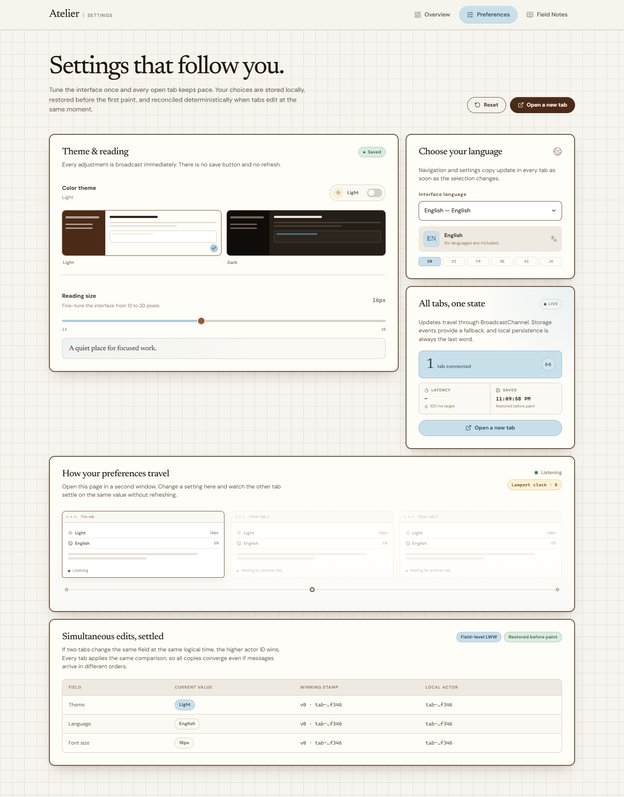
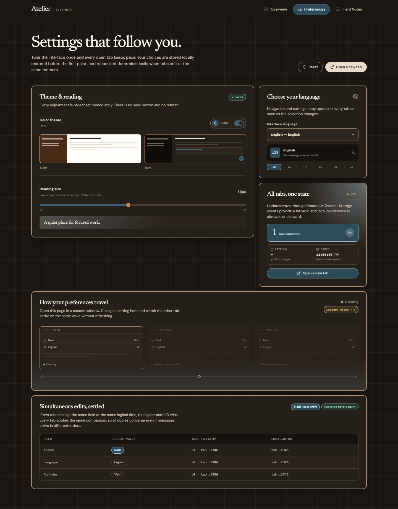

# Atelier Settings

A production-quality implementation of **Task 1: Multi-Tab Settings Synchronization** for the GDG Tech Wildcard frontend brief.

Atelier Settings synchronizes theme, interface language, and reading size across every open tab in real time. It uses a field-level last-write-wins strategy backed by Lamport clocks, with deterministic actor-ID tie-breaking. Preferences are persisted locally and restored before the first paint so a dark theme never flashes light on load.



## Highlights

- **Real-time synchronization** through `BroadcastChannel`, targeting sub-100 ms propagation. `storage` events provide a fallback transport.
- **Deterministic conflict resolution** per field using Lamport timestamps and lexicographic actor IDs.
- **Persistence** in `localStorage`, with defensive hydration and safe defaults for corrupt data.
- **No theme flash**: a pre-paint inline script applies theme, language, and type size before React mounts.
- **Live presence and latency**: heartbeat, ping/pong, connected-tab count, transport status, and measured round-trip latency.
- **Six interface languages**, defaulting to English: English, Spanish, French, German, Hindi, and Japanese.
- **Responsive layout** matching the supplied reference: graph-paper canvas, coffee-and-cream top bar, powder-blue accents, display serif, and generous card spacing.
- **Unit-tested merge logic**, including concurrent-edit convergence in both merge directions.
- **Accessibility**: semantic controls, visible focus states, `aria-live` sync announcements, keyboard-operable UI, and reduced-motion support.

| Light | Dark |
| --- | --- |
|  |  |

## Quick start

Requirements: Node.js 20.19+ (or 22.12+) and npm.

```bash
cd apps/settings-sync
npm install
npm run dev
```

Open the printed URL, then open it in a second tab. Change the theme, language, or font size in either tab; both tabs update immediately.

### Production build

```bash
npm run build
npm run preview
```

### Tests

```bash
npm test          # single run
npm run test:watch
```

The current suite covers deterministic merge ordering, concurrent edits across different fields, three-way convergence, font normalization, record reset semantics, and defensive hydration of malformed persisted data.

## Manual cross-tab checklist

1. Open the app in two tabs at the same origin.
2. Confirm the sync card reports two connected tabs and its **Live** pill is lit.
3. Toggle dark mode in tab A. Tab B should update in well under 100 ms with no refresh.
4. Change the language in tab B. Navigation and preferences copy should update in tab A.
5. Drag the font slider in either tab. The other tab should track the size in real time.
6. Close all tabs and reopen the app. The last theme, language, and size should be restored.
7. Open a new tab while the current theme is dark. The first frame should already be dark.
8. Change the same field in both tabs at nearly the same instant. Both tabs should settle on the same value.

## Architecture

```text
src/
  components/
    AppShell.tsx              Responsive application frame
    TopNav.tsx                Top navigation bar
    PageHeader.tsx            Shared page header
    Panel.tsx                 Surface primitive
    preferences/
      AppearancePanel.tsx     Theme toggle, previews, font slider
      LanguagePanel.tsx       Language selector and active-language summary
      SyncPanel.tsx           Presence, latency, persistence status
      SyncLab.tsx             Visual multi-tab synchronization demo
      ConflictPanel.tsx       Per-field stamp ledger
      ThemePreview.tsx        Theme preview illustration
      format.ts               Stamp/actor formatting helpers
  pages/
    HomePage.tsx              Overview
    PreferencesPage.tsx       Settings composition
    NotesPage.tsx             Technical explanation
  preferences/
    types.ts                  Preference, stamp, message, and sync types
    merge.ts                  Pure Lamport merge and normalization logic
    storage.ts                Safe localStorage and document application
    engine.ts                 Transport, presence, latency, and lifecycle
    PreferencesProvider.tsx   React state subscription and hooks
    i18n.ts                   Typed six-language dictionaries
    merge.test.ts             Deterministic merge unit tests
  styles/
    tokens.css                Palette, type, spacing, motion tokens
    base.css                  Reset, focus, scrollbars, motion preferences
    app.css                   Layout and component styles
```

### Data flow

```text
 user control
     │
     ▼
PreferencesEngine.setPreference(key, value)
     │
     ├─ increment Lamport clock
     ├─ replace only that field's stamp
     ├─ merge-safe immutable record
     ├─ persist to localStorage
     ├─ apply to <html> (theme, lang, font size)
     ├─ notify React subscribers
     └─ post { type: "state", state } to BroadcastChannel
                    │
                    ▼
            other open tabs
                    │
                    ▼
        mergeRecords(local, incoming)
                    │
                    ├─ higher (clock, actor) wins per field
                    ├─ persist merged record
                    ├─ apply if values changed
                    └─ notify local React subscribers
```

The `storage` event handler runs the same merge path. Duplicate delivery through both transports is harmless because merging is idempotent and monotonic.

## Synchronization strategy

### Transport

1. **Primary:** `BroadcastChannel("atelier.settings.sync.v1")` sends typed messages directly between same-origin tabs.
2. **Fallback:** the `storage` event observes writes to `atelier.settings.v1` when a channel is unavailable.
3. **Presence:** each tab broadcasts `hello` on mount and `heartbeat` every 2.5 seconds. Peers expire after 7 seconds.
4. **Latency:** a ping is sent every 4.5 seconds; peers respond with `pong`. The UI reports the measured round trip. State messages also carry a `sentAt` timestamp for per-update latency display.

Messages are not debounced. A control change produces one state message immediately, so propagation is bounded by the browser's channel scheduler rather than network or server latency.

### Conflict resolution

Each preference field has its own version stamp:

```ts
interface Stamp {
  clock: number;   // Lamport logical clock
  actor: string;   // stable per-tab ID, used only as a tie-breaker
  at: number;      // wall clock, display only
}
```

Ordering is lexicographic:

```text
(a, b) > (c, d)  ⇔  a > c  ∨  (a = c ∧ b > d)
```

A local edit increments the record clock and stamps only the changed field with `(clock, actor)`. An incoming record wins a field only when its stamp is greater. Different fields merge independently, so simultaneous theme and language changes both survive.

The important property is **order independence**. For any two records `A` and `B`:

```text
merge(A, B) == merge(B, A)
```

and for three records, association order does not change the winning `(clock, actor)` pair per field. Every tab compares the same values with the same rule, so all tabs converge even if messages arrive in different orders.

Wall-clock time is never used for ordering. Two machines or tabs with skewed clocks cannot produce divergent outcomes.

### Persistence and boot

The full preference record is written to `localStorage` on every change and on every merged remote update. A small inline script in `index.html` reads the same record before React is loaded and applies:

- `data-theme` on `<html>`
- `lang` on `<html>`
- `--app-font-size`
- the browser `theme-color` meta tag

React then hydrates from the same stored record synchronously. This removes the usual flash-of-incorrect-theme on cold starts and newly opened tabs.

Corrupt or partial records are sanitized during hydration: invalid theme values fall back to light, unknown languages to English, and font sizes are clamped to 13–20 px. A corrupt record never prevents boot.

## Supported preferences

| Preference | Values | Notes |
| --- | --- | --- |
| Theme | light, dark | Instantly applied and persisted |
| Language | `en`, `es`, `fr`, `de`, `hi`, `ja` | Defaults to English; navigation and settings copy translate |
| Font size | 13–20 px | Applied at the document root so the interface scales coherently |

## Tech stack

- React 19 + TypeScript 7
- Vite 8
- `lucide-react` icons
- Newsreader + DM Sans variable fonts (`@fontsource-variable`)
- Vitest for merge-engine tests

No state-management or synchronization library is used; the merge algorithm and transport layer are implemented directly in the repository.

## Deployment

The app is a static Vite build and can be deployed to any static host.

### Vercel

- Root directory: `apps/settings-sync`
- Framework preset: Vite
- Build command: `npm run build`
- Output directory: `dist`

### Netlify

```text
Base directory: apps/settings-sync
Build command: npm run build
Publish directory: dist
```

The app uses hash routing (`#/preferences`, `#/notes`), so no SPA rewrite rules are required.

## Browser support

BroadcastChannel is supported in current Chrome, Edge, Firefox, and Safari. Where it is unavailable, the storage-event fallback keeps tabs synchronized. The design also includes a storage-only transport label so the active mechanism is visible.

## Scope and limitations

- Synchronization is scoped to tabs of the same origin in the same browser profile, which matches the brief.
- A future server-backed adapter could replace the transport while keeping the same pure merge layer.
- Wall-clock timestamps are displayed for saved-time context but never participate in conflict ordering.

## License

MIT
