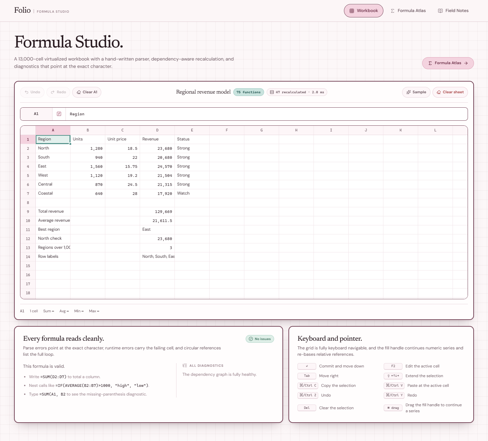
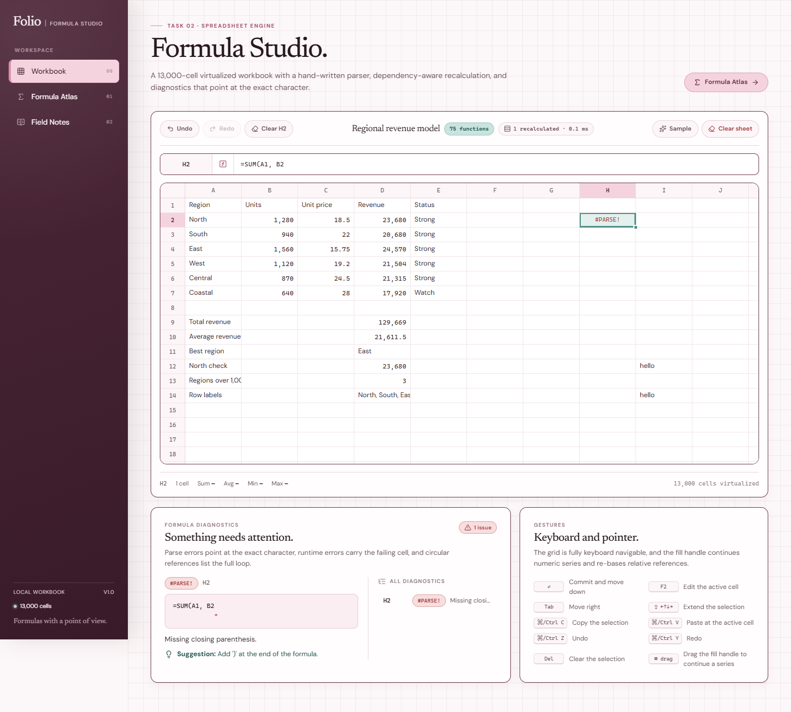
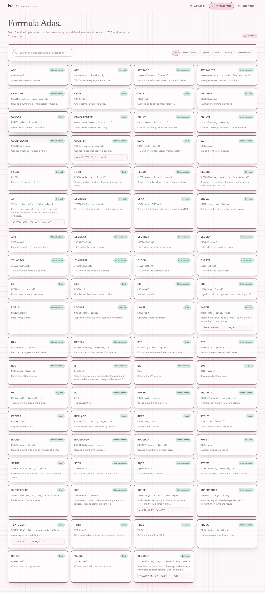

# Folio · Formula Studio

Task 02 — a spreadsheet with a **custom formula engine** written from scratch in TypeScript, running on a virtualized 13,000-cell grid.

- 500 rows × 26 columns = **13,000 cells**, with only the visible window mounted in the DOM.
- A hand-written **tokenizer → recursive-descent parser → evaluator**; no third-party formula or spreadsheet library.
- A **dependency graph** with breadth-first affected-set recalculation and direct + indirect **circular-reference detection**.
- **75 built-in functions** across five categories (`SUM`, `IF`, `VLOOKUP`, `INDEX`, `MATCH`, `TEXTJOIN`, …).
- **Diagnostics** that point a caret at the exact character and suggest a fix.



## Table of contents

- [Highlights](#highlights)
- [Tech stack](#tech-stack)
- [Getting started](#getting-started)
- [Project structure](#project-structure)
- [Architecture](#architecture)
  - [1. Tokenizer](#1-tokenizer)
  - [2. Parser](#2-parser)
  - [3. Evaluator](#3-evaluator)
  - [4. Dependency graph and incremental recalculation](#4-dependency-graph-and-incremental-recalculation)
  - [5. Circular-reference detection](#5-circular-reference-detection)
  - [6. Diagnostics](#6-diagnostics)
  - [7. Fill handle and relative references](#7-fill-handle-and-relative-references)
  - [8. Virtualized grid](#8-virtualized-grid)
- [Function reference](#function-reference)
- [Keyboard and pointer reference](#keyboard-and-pointer-reference)
- [Testing](#testing)
- [Deployment](#deployment)

## Highlights

| Requirement | Where it lives |
| --- | --- |
| ≥ 10,000 cells | `SHEET_ROWS = 500`, `SHEET_COLS = 26` → `CELL_COUNT = 13,000` (`src/spreadsheet/types.ts`) |
| Virtualization | `src/components/sheet/SheetGrid.tsx` (row **and** column windowing with overscan) |
| Selection, editing, keyboard nav | `SheetGrid.tsx` + `useSheetState.ts` |
| Formula bar | `src/components/sheet/FormulaBar.tsx` |
| Drag-fill | `src/spreadsheet/fill.ts` + fill handle in `SheetGrid.tsx` |
| Undo / redo | `Workbook` history (`src/spreadsheet/workbook.ts`) |
| Custom parser | `src/spreadsheet/tokenizer.ts`, `src/spreadsheet/parser.ts` |
| ≥ 30 functions (SUM, IF, VLOOKUP) | `src/spreadsheet/functions.ts` — **75 functions** |
| Ranges + nested formulas | AST nodes `range` / `function` in `parser.ts`, evaluated in `workbook.ts` |
| Dependency graph + incremental recalc | `dependencies` / `dependents` maps in `workbook.ts` |
| Direct + indirect cycle detection | `visitState` + call stack in `workbook.ts` → `#CYCLE!` |
| Error diagnostics with caret + suggestion | `src/components/sheet/DiagnosticsPanel.tsx` |

## Tech stack

- **React 19** + **TypeScript** (strict) + **Vite**
- **lucide-react** for icons, `@fontsource-variable` Newsreader + DM Sans for type
- **Vitest** for the engine test suite
- **oxlint** for linting
- No spreadsheet, parser, or formula dependencies — the engine is entirely first-party code.

## Getting started

```bash
# from the repository root
npm run install:all
npm run dev:spreadsheet          # http://localhost:5174
```

Or run the app on its own:

```bash
cd apps/spreadsheet
npm install
npm run dev                      # http://localhost:5174
npm run build                    # type-check + production build to dist/
npm run preview                  # serve the production build
npm test                         # run the engine test suite once
npm run lint
```

Requires **Node ≥ 20.19**.

## Project structure

```text
apps/spreadsheet/
  src/
    spreadsheet/                 # the engine (framework-free, fully testable)
      types.ts                   # sheet dimensions, cell/range/error/value types
      coordinates.ts             # A1 ↔ {row,col}, ranges, labels, iteration
      tokenizer.ts               # raw text → typed tokens (with source offsets)
      parser.ts                  # tokens → AST (recursive descent, precedence-climbing)
      functions.ts               # the 75-function registry
      diagnostics.ts             # error helpers, formatting, Levenshtein suggestions
      fill.ts                    # series detection + relative-reference translation
      workbook.ts                # dependency graph, recalc, cycles, history
      sample.ts                  # the starter workbook
      useWorkbook.ts             # React binding for the Workbook
      useSheetState.ts           # selection / editing state machine
    components/
      AppShell.tsx, Sidebar.tsx, PageHeader.tsx, Panel.tsx
      sheet/                     # SheetGrid, FormulaBar, SheetToolbar,
                                 # DiagnosticsPanel, WorkbookStatusBar
    pages/                       # WorkbookPage, FormulaAtlasPage, NotesPage
    styles/                      # tokens.css, base.css, app.css, sheet.css
  docs/                          # screenshots + generated function reference
  vercel.json, netlify.toml      # one-command deploys
```

## Architecture

The engine is deliberately split from React. `src/spreadsheet/*` is pure TypeScript and holds all evaluation logic; the components only render values and forward user intent. This keeps the engine unit-testable without a DOM.

```text
 "=IF(SUM(A1:A3) > 10, \"big\", \"small\")"
        │
        ▼  tokenizer.ts
 [ IF, (, SUM, (, A1, :, A3, ), >, 10, ,, "big", ,, "small", ) ]
        │
        ▼  parser.ts  (precedence climbing)
 FunctionNode(IF)
   ├─ BinaryNode(>)
   │    ├─ FunctionNode(SUM) → RangeNode(A1:A3)
   │    └─ NumberNode(10)
   ├─ StringNode("big")
   └─ StringNode("small")
        │
        ▼  workbook.ts  (evaluateNode)
  numbers ──▶ dependency edges ──▶ values + diagnostics
```

### 1. Tokenizer

`tokenize(expression)` walks the formula body and emits tokens with `start`/`end` offsets, so every later error can point back at the source: numbers, quoted strings, cell/range references (with `$` absolutes), operators, comparison operators, commas, parentheses, booleans, and identifiers.

A subtlety: `SUM(` and `A1` both begin with letters. The tokenizer disambiguates by checking whether the run of letters is followed by digits (a cell reference) or an opening parenthesis (a function name).

### 2. Parser

`parseExpression(body)` is a recursive-descent parser, one function per precedence level:

```text
expression     → comparison
comparison     → concat ( ("=" | "<>" | "<" | ">" | "<=" | ">=") concat )*
concat         → additive ( "&" additive )*
additive       → multiplicative ( ("+" | "-") multiplicative )*
multiplicative → power ( ("*" | "/") power )*
power          → unary ( "^" power )?          // right associative
unary          → ("+" | "-") unary | postfix
postfix        → primary "%"?
primary        → number | string | boolean
               | cell | cell ":" cell
               | IDENT "(" arguments ")"
               | "(" expression ")"
```

Every node carries `start`/`end`, which is what makes character-accurate diagnostics possible. Parse failures throw a `FormulaSyntaxError` carrying a message, a position, an optional length, a machine-readable code (`#PARSE!`, `#REF!`, `#ARGS!`), and a human suggestion.

### 3. Evaluator

The evaluator lives in `Workbook.evaluateNode` and walks the AST lazily:

- **Cells** resolve through `evaluateCell`, which recursively evaluates dependencies and memoizes results.
- **Ranges** materialize into a `RangeValue { rows, cols, values }` so aggregate functions can consume them.
- **Operators** coerce operands (blank → 0, `TRUE`/`FALSE` → 1/0, numeric text → number) and raise typed errors such as `#DIV/0!`.
- **`IF`, `IFERROR`, and `IFNA` are special-cased** so only the taken branch is evaluated. This is why `=IF(A1=0, "safe", 1/A1)` returns `"safe"` instead of `#DIV/0!`.

Errors are values, not exceptions: they flow through the graph like any other value and can be caught with `IFERROR`.

### 4. Dependency graph and incremental recalculation

Each formula cell contributes two adjacency structures:

- `dependencies[cell]` — the set of cells it reads.
- `dependents[cell]` — the set of cells that read it.

On an edit the engine:

1. **Rebuilds the edited cell's own edges** from the freshly parsed AST (so rewriting `=A1` as `=A2` moves the edge from `A1` to `A2`).
2. **Collects the affected set** with a breadth-first walk over `dependents`, starting from the changed cells.
3. **Resets and recomputes only that set**, recursing into dependencies as needed.

The result is exposed as a live badge (`N recalculated · X ms`) so the incremental behaviour is visible. A single edit recalculates the affected sub-graph, not the whole sheet.

### 5. Circular-reference detection

Evaluation tracks a per-cell `visiting` / `done` state plus an explicit call stack. Re-entering a cell that is already `visiting` is a cycle:

```text
evaluate(C1)
  visitState[C1] = "visiting", stack = [C1]
  → references A1 → evaluate(A1)
      visitState[A1] = "visiting", stack = [C1, A1]
      → references C1 → evaluate(C1)
          visitState[C1] === "visiting"   ← cycle detected
          path = stack.slice(indexOf(C1)) + C1 = [C1, A1, C1]
          every member is flagged with #CYCLE!
```

This catches **direct** self-references (`=A1+1` in `A1`) and **indirect** cycles (`A1 → B1 → C1 → A1`) alike, reports the full loop in the diagnostic message, and recovers cleanly if the cycle is later broken.

### 6. Diagnostics

Every error is a value of shape `{ kind: "error", code, message, position?, length?, suggestion? }`. The diagnostics panel renders the offending formula, places a caret at the recorded offset, and shows the suggestion:

```text
Formula:  =SUM(A1, B2
Error:    Missing closing parenthesis.
          =SUM(A1, B2
                     ^
Suggestion: Add ')' at the end of the formula.
```

Runtime diagnostics keep the failing cell and message. Unknown functions are matched against the registry using a small Levenshtein distance, so `=SUMM(...)` suggests `SUM`, and `=VLOKUP(...)` suggests `VLOOKUP`. The panel also lists every outstanding diagnostic across the sheet and lets you jump to the offending cell.



### 7. Fill handle and relative references

Dragging the fill handle over a selection expands it (see `buildFillUpdates` in `fill.ts`):

- **Numeric runs** continue their step: `10, 20` → `… 30, 40, 50` (a single number copies).
- **Formulas** are translated relative to the source block. Relative references shift, `$`-anchored references stay put, and references that would leave the sheet are left untouched: `=B2*2` filled down becomes `=B3*2`, `=B4*2`, …
- **Anything else** repeats cyclically.

### 8. Virtualized grid

`SheetGrid.tsx` computes the visible row and column window from `scrollTop` / `scrollLeft` plus a small overscan, and mounts only those cells (a few hundred nodes out of 13,000). Column and row headers are kept in sync through a transform rather than being rebuilt, giving frozen labels without duplicating the grid. Cell values are memoized inside the engine and parsing is cached per raw string, so scrolling and re-rendering stay cheap.



## Function reference

The engine ships **75 functions**. Arguments in `[brackets]` are optional. The same catalogue powers the in-app **Formula Atlas** (searchable, filterable by category).

| Function | Signature | Description |
| --- | --- | --- |
| **Math & stats** | | |
| `ABS` | `ABS(number)` | Absolute value of a number. |
| `AVERAGE` | `AVERAGE(number1, [number2], …)` | Returns the arithmetic mean of numeric values. |
| `AVERAGEIF` | `AVERAGEIF(range, criteria, [average_range])` | Averages values that satisfy a criteria. |
| `CEILING` | `CEILING(number, [significance])` | Rounds a number up to the nearest multiple. |
| `COUNT` | `COUNT(value1, [value2], …)` | Counts how many values are numbers. |
| `COUNTA` | `COUNTA(value1, [value2], …)` | Counts non-empty values in the arguments. |
| `COUNTBLANK` | `COUNTBLANK(range)` | Counts empty cells inside a range. |
| `COUNTIF` | `COUNTIF(range, criteria)` | Counts values that satisfy a criteria. |
| `EXP` | `EXP(number)` | e raised to the given power. |
| `FLOOR` | `FLOOR(number, [significance])` | Rounds a number down to the nearest multiple. |
| `INT` | `INT(number)` | Rounds down to the nearest integer. |
| `LN` | `LN(number)` | Natural logarithm. |
| `LOG` | `LOG(number, [base])` | Logarithm with an optional base, defaulting to 10. |
| `LOG10` | `LOG10(number)` | Base-10 logarithm. |
| `MAX` | `MAX(number1, [number2], …)` | Returns the largest numeric value. |
| `MEDIAN` | `MEDIAN(number1, [number2], …)` | Returns the middle number of a data set. |
| `MIN` | `MIN(number1, [number2], …)` | Returns the smallest numeric value. |
| `MOD` | `MOD(number, divisor)` | Remainder after division. |
| `PI` | `PI()` | The constant π. |
| `POWER` | `POWER(number, power)` | Raises a number to a power. |
| `PRODUCT` | `PRODUCT(number1, [number2], …)` | Multiplies all numeric values together. |
| `ROUND` | `ROUND(number, [digits])` | Rounds a number to a given number of digits. |
| `ROUNDDOWN` | `ROUNDDOWN(number, [digits])` | Rounds a number toward zero. |
| `ROUNDUP` | `ROUNDUP(number, [digits])` | Rounds a number away from zero. |
| `SIGN` | `SIGN(number)` | Returns -1, 0, or 1 for the sign of a number. |
| `SQRT` | `SQRT(number)` | Square root of a number. |
| `STDEV` | `STDEV(number1, [number2], …)` | Sample standard deviation of numeric values. |
| `SUM` | `SUM(number1, [number2], …)` | Adds every numeric value across arguments and ranges. Text and blanks are ignored. |
| `SUMIF` | `SUMIF(range, criteria, [sum_range])` | Adds values that satisfy a criteria. Supports `> < >= <= <>` and the wildcards `*` and `?`. |
| `SUMPRODUCT` | `SUMPRODUCT(range1, [range2], …)` | Multiplies equally sized ranges element by element, then sums the result. |
| `TRUNC` | `TRUNC(number, [digits])` | Truncates a number toward zero. |
| **Logical** | | |
| `AND` | `AND(logical1, [logical2], …)` | TRUE when every argument is true. |
| `FALSE` | `FALSE()` | Returns the boolean FALSE. |
| `IF` | `IF(test, true_value, [false_value])` | Returns one value when the test is true and another when false. Only the taken branch is evaluated. |
| `IFERROR` | `IFERROR(value, fallback)` | Returns the fallback when the value is an error. |
| `IFNA` | `IFNA(value, fallback)` | Returns the fallback only when the value is `#N/A`. |
| `NOT` | `NOT(logical)` | Reverses a boolean value. |
| `OR` | `OR(logical1, [logical2], …)` | TRUE when any argument is true. |
| `TRUE` | `TRUE()` | Returns the boolean TRUE. |
| **Text** | | |
| `CHAR` | `CHAR(code)` | Character for a numeric code. |
| `CODE` | `CODE(text)` | Numeric code of the first character. |
| `CONCAT` | `CONCAT(value1, [value2], …)` | Joins values into one text string. |
| `CONCATENATE` | `CONCATENATE(value1, [value2], …)` | Joins values into one text string. |
| `EXACT` | `EXACT(text1, text2)` | TRUE when two text values match exactly. |
| `FIND` | `FIND(needle, text, [start])` | Case-sensitive position of text inside another value. |
| `LEFT` | `LEFT(text, [length])` | First characters of a text value. |
| `LEN` | `LEN(text)` | Number of characters in a text value. |
| `LOWER` | `LOWER(text)` | Converts text to lowercase. |
| `MID` | `MID(text, start, length)` | Characters from the middle of a text value. |
| `PROPER` | `PROPER(text)` | Capitalizes each word. |
| `REPLACE` | `REPLACE(text, start, length, new)` | Replaces part of a text value by position. |
| `REPT` | `REPT(text, count)` | Repeats a text value. |
| `RIGHT` | `RIGHT(text, [length])` | Last characters of a text value. |
| `SEARCH` | `SEARCH(needle, text, [start])` | Case-insensitive position of text inside another value. |
| `SUBSTITUTE` | `SUBSTITUTE(text, old, new, [occurrence])` | Replaces text inside a value. |
| `TEXTJOIN` | `TEXTJOIN(delimiter, ignore_empty, value1, …)` | Joins values with a delimiter. |
| `TRIM` | `TRIM(text)` | Removes leading, trailing, and repeated spaces. |
| `UPPER` | `UPPER(text)` | Converts text to uppercase. |
| `VALUE` | `VALUE(text)` | Converts numeric text to a number. |
| **Lookup** | | |
| `COLUMNS` | `COLUMNS(range)` | Number of columns in a range. |
| `HLOOKUP` | `HLOOKUP(value, range, row, [approximate])` | Searches the first row of a range and returns a value from another row. |
| `INDEX` | `INDEX(range, row, [column])` | Returns a value at a position inside a range. |
| `LOOKUP` | `LOOKUP(value, range)` | Approximate lookup in a single row or column. |
| `MATCH` | `MATCH(value, range, [type])` | Position of a value inside a range. Type 0 is exact, 1 ascending, -1 descending. |
| `ROWS` | `ROWS(range)` | Number of rows in a range. |
| `VLOOKUP` | `VLOOKUP(value, range, column, [approximate])` | Searches the first column of a range and returns a value from another column. Exact by default. |
| **Information** | | |
| `ISBLANK` | `ISBLANK(value)` | TRUE when the value is empty. |
| `ISERROR` | `ISERROR(value)` | TRUE when the value is any error. |
| `ISEVEN` | `ISEVEN(number)` | TRUE when the number is even. |
| `ISLOGICAL` | `ISLOGICAL(value)` | TRUE when the value is a boolean. |
| `ISNUMBER` | `ISNUMBER(value)` | TRUE when the value is a number. |
| `ISODD` | `ISODD(number)` | TRUE when the number is odd. |
| `ISTEXT` | `ISTEXT(value)` | TRUE when the value is text. |
| `N` | `N(value)` | Converts a value to a number: booleans become 1 or 0, numbers stay, everything else becomes 0. |
| `NA` | `NA()` | Returns the `#N/A` error. |

A machine-readable copy lives in [`docs/function-reference.md`](docs/function-reference.md).

## Keyboard and pointer reference

| Input | Action |
| --- | --- |
| Click / drag | Select a cell or range |
| `Shift` + arrows | Extend the selection |
| `Enter` / `Shift+Enter` | Commit and move down / up |
| `Tab` / `Shift+Tab` | Commit and move right / left |
| Typing any character | Start editing the active cell |
| `F2` | Edit the active cell |
| `Esc` | Cancel editing |
| `Delete` / `Backspace` | Clear the selection |
| `Ctrl/Cmd + C` / `X` / `V` | Copy / cut / paste (tab-separated, Excel-compatible) |
| `Ctrl/Cmd + Z` / `Y` | Undo / redo |
| `Ctrl/Cmd + A` | Select all |
| Drag the fill handle | Fill a series / translate formulas |
| Click a row or column header | Select that row or column |

## Testing

The engine has its own Vitest suite that exercises the parser, evaluator, dependency graph, cycle detection, history, and selection statistics:

```bash
cd apps/spreadsheet
npm test
```

Covered behaviours include:

- The brief's exact diagnostic: `=SUM(A1, B2` → `Missing closing parenthesis.` with the caret at the end and the suggestion `Add ')' at the end of the formula.`
- Operator precedence, ranges, aggregation, nesting, and lookups (`VLOOKUP`, `INDEX`, `MATCH`).
- Lazy evaluation (`IF` does not evaluate the untaken branch).
- Runtime errors (`#DIV/0!`, `#REF!`, `#NAME?`, `#ARGS!`, `#VALUE!`) and typo suggestions.
- Incremental recalculation (only the affected set is recomputed).
- Dependency rewrites (changing `=A1` to `=A2` moves the edge).
- Direct and indirect cycles, and recovery after a cycle is broken.
- Undo/redo, batched edits, and selection statistics.

## Deployment

This app is a static Vite build, so it deploys anywhere that serves a directory. Configs are included:

- **Vercel** — `vercel.json`
- **Netlify** — `netlify.toml`

### Vercel

```bash
cd apps/spreadsheet
npx vercel            # preview
npx vercel --prod     # production
```

Set the project **root directory** to `apps/spreadsheet` (or deploy from inside the folder) so the build command `npm run build` and output directory `dist` resolve correctly.

### Netlify

```bash
cd apps/spreadsheet
npx netlify deploy --build          # draft
npx netlify deploy --build --prod   # production
```

The included `netlify.toml` sets `command = "npm run build"` and `publish = "dist"`.

### Any static host

```bash
npm run build
# then upload the contents of dist/
```

> The repository does not ship a live deployment URL from this environment; the configuration above reproduces the deploy in one command.

---

Built for the **GDG Tech Wildcard — Task 02** brief. See the sibling app in [`apps/settings-sync`](../settings-sync) for Task 01.
